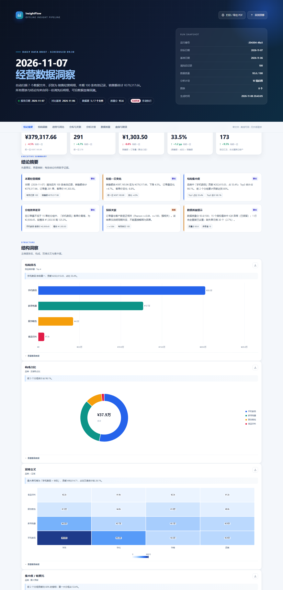
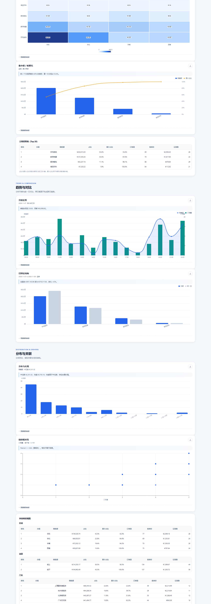
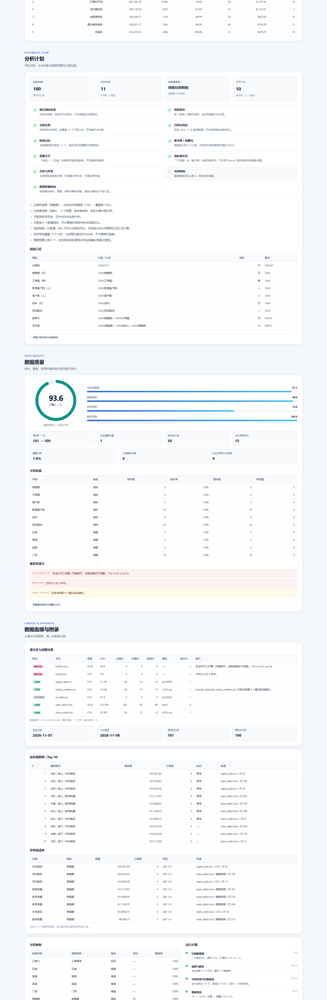
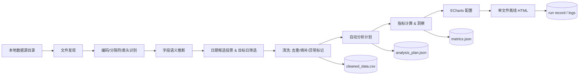

# InsightFlow · 本地数据洞察流水线

> 每天 09:30 自动扫描本地 Excel / CSV，识别字段、清洗数据、生成分析计划、计算指标、绘制图表，最终产出一个**双击即可离线查看的单文件 HTML 报告**。

一个面向作品集展示的「商业级数据处理分析服务工作流」：不是一次性分析脚本，而是带**调度、并发锁、幂等、异常边界、结构化运行日志、可复现产物**的完整小型数据产品。

> **第一次使用？** 先看 [零基础使用教程（HTML，双击即可打开）](docs/使用教程.html)。里面包含原理、如何导入数据、数据规范、输出位置和常见错误排障。
>
> **质量修复记录** 见 [CHANGELOG.md](CHANGELOG.md)；P0/P1 回归测试在 [tests/test_defects.py](tests/test_defects.py)。



<p align="center"><i>示例报告由仓库内合成演示数据生成；完整文件见 <a href="docs/sample_report.html">docs/sample_report.html</a></i></p>

| 趋势与分布 | 质量与血缘 |
|---|---|
|  |  |

---

## 1. 30 秒体验

环境：Windows + Python 3.10+，依赖 `pandas / openpyxl / xlrd`。

```powershell
cd insightflow
python -m pip install -r requirements.txt
# 需要精确复现环境时改用：python -m pip install -r requirements.lock.txt

# 生成合成演示数据，并立即运行一次（默认昨天为报告日）
.\run.ps1 demo --date 2026-11-07

# 打开单文件报告
start output\latest.html
```

也可以直接执行已有示例数据：

```powershell
.\run.ps1 run --date 2026-11-07 --force
```

> 示例数据故意包含：GBK 文件、带 BOM 文件、乱码表头、封面 Sheet、空文件、损坏 xlsx、无日期文件、缺失值、完全重复行和 IQR 异常值。报告会如实记录这些兼容性处理。

---

## 2. 需求映射

| 需求 | 实现 |
|---|---|
| 指定本地文件夹作为数据源 | `config.json → source_dir`，支持递归扫描 |
| 仅 Excel / CSV | `.xlsx`、`.xls`、`.csv`，可配置扩展名 |
| 每日 09:30 定时触发 | Windows Task Scheduler 注册 + 跨平台内置 daemon |
| 读取前一日全部数据 | 目标日期默认「配置时区的前一自然日」；严格按日期筛选，不做“最新文件猜日期” |
| 自动识别字段与数据条目 | 表头检测、别名映射、类型推断、日期候选投票、单位换算 |
| 自动判断分析方向并生成计划 | 规则化 `AnalysisPlan`：主指标、主维度、图表预算、每项启用/跳过原因 |
| 自动清洗 | 文本标准化、日期归一、去重、缺失填补、IQR 异常标记、乱码修复 |
| 自动分析 / 统计指标 | KPI、环比、结构占比、Pareto、分布、相关性、毛利、分组效率 |
| 自动可视化 | 内联 ECharts；图表下方附带可核对数据表 |
| 单文件离线 HTML | CSS / JS / ECharts 全部内联；无 CDN、无 fetch、无后端 |
| 异常兼容 | 空文件、损坏文件、编码、乱码、字段缺失、无目标数据、无新数据、锁冲突 |
| 定时任务日志 | `logs/runs.jsonl` + 每次运行一个 JSON + 文本日志；含触发时间、读取文件、是否生成报告、失败原因 |

---

## 3. 它和“普通分析脚本”的区别

- **可审计**：每个数字都能追到清洗后明细；报告内含数据血缘、字段映射、指标公式、异常清单和运行步骤耗时。
- **可恢复**：单个坏文件不会中断整批任务；报告渲染失败会留下结构化失败记录。
- **可重复**：不使用随机分析逻辑；同一输入得到同一指标和结论。合成演示数据也固定随机种子。
- **可调度**：文件锁防止定时任务与手动任务并发写坏报告；数据指纹避免重复生成。
- **可交付**：报告是单文件，不需要 Python、数据库、Web 服务或网络；打印 / 导出 PDF、单图 PNG 都可用。
- **工程化**：`src/` 包结构、dataclass 数据契约、类型注解、中文注释、41 个单元/集成测试；P0/P1 回归测试见 `tests/test_defects.py`。

---

## 4. 工作流



更完整的模块边界、数据契约和扩展点见 [docs/architecture.md](docs/architecture.md)。

---

## 5. 目录结构

```text
insightflow/
├─ config/
│  ├─ config.json                 # 实际运行配置
│  └─ config.example.json         # 可提交的配置模板
├─ src/insightflow/
│  ├─ cli.py                      # run / scan / demo / logs / schedule / init
│  ├─ pipeline.py                 # 编排、锁、幂等、日志、产物
│  ├─ discovery.py                # 数据源扫描
│  ├─ readers.py                  # CSV/Excel 读取、编码、分隔符、表头
│  ├─ schema.py                   # 字段语义识别与画像
│  ├─ normalize.py                # 日期候选、目标期筛选、规范列
│  ├─ cleaning.py                 # 清洗与质量报告
│  ├─ planner.py                  # 分析计划
│  ├─ analysis.py                 # KPI / 结构 / 分布 / 相关性 / 图表数据
│  ├─ report.py                   # 单文件 HTML 渲染
│  ├─ scheduler.py                # Windows 任务 + daemon
│  ├─ logging_setup.py            # 文本日志 + JSONL
│  ├─ templates/report.html       # 内联 CSS/JS 模板
│  └─ assets/echarts.min.js       # 离线图表库
├─ scripts/
│  ├─ generate_sample_data.py     # 可复现的“脏数据”生成器
│  └─ run_scheduled.ps1           # 计划任务入口
├─ tests/                         # unittest，无额外测试依赖
├─ examples/raw/                  # 合成演示数据（含坏文件）
├─ output/                        # 报告、计划、指标、清洗明细
├─ logs/                          # 运行日志与 JSONL
├─ state/                         # 幂等索引、锁、调度状态
└─ docs/                          # 架构、异常矩阵、示例报告、截图
```

---

## 6. 配置

编辑 [config/config.json](config/config.json)：

```json
{
  "timezone": "Asia/Shanghai",
  "source_dir": "examples/raw",
  "output_dir": "output",
  "log_dir": "logs",
  "state_dir": "state",
  "schedule_time": "09:30",
  "date_order": "month_first",
  "recursive_scan": true,
  "include_extensions": [".xlsx", ".xls", ".csv"],
  "max_file_mb": 50,
  "max_rows_per_file": 200000,
  "outlier_iqr_k": 1.5,
  "max_charts": 8,
  "comparison": { "enabled": true, "lookback_days": 1 },
  "report": {
    "title": "每日经营数据洞察报告",
    "company": "InsightFlow · Portfolio Demo"
  },
  "scheduler": {
    "task_name": "InsightFlow_Daily_0930",
    "grace_minutes": 180
  }
}
```

关键口径：

- **目标日期**：`previous_day` = 配置时区的前一自然日。定时器 09:30 触发时，默认分析昨天。
- **日期歧义**：`03/04/2026` 这类无法区分日/月的值默认按 **月/日/年** 解析为 2026-03-04；欧式日/月数据请把 `date_order` 设为 `day_first`，或直接使用 `YYYY-MM-DD`。检测到歧义值会写 warning。
- **对比基准**：默认取目标日前 1 天；基准不存在时报告明确显示“无基准”，不编造环比。
- **图表预算**：`max_charts` 限制报告长度；被预算挤掉的分析项会记录跳过原因。
- **字段单位**：支持 `销售额(万元)` 等表头单位换算；单元格自带 `1.2万` 时不会重复乘。
- **数据源**：相对路径基于项目根目录，不依赖启动时的当前工作目录。

把 `source_dir` 换成你的真实目录即可；支持子目录（`recursive_scan=true`）。

---

## 7. 命令

```powershell
# 运行（默认昨天）
.\run.ps1 run

# 指定日期 / 强制重算
.\run.ps1 run --date 2026-11-07 --force

# 临时覆盖数据源
.\run.ps1 run --date 2026-11-07 --source "D:\exports\daily"

# 只扫描与预览字段/日期命中情况，不生成报告
.\run.ps1 scan --date 2026-11-07

# 生成演示数据并运行
.\run.ps1 demo --date 2026-11-07

# 最近运行记录
.\run.ps1 logs --limit 10

# 初始化目录与配置
.\run.ps1 init
```

`run` 退出码：`0` 成功；`1` 失败；`2` 无目标日数据；`3` 幂等跳过 / 并发跳过。`--json` 可输出机器可读运行记录。

---

## 8. 定时任务

### 8.1 Windows 计划任务（推荐）

```powershell
# 先预览将写入系统的任务 XML，不产生副作用
.\run.ps1 schedule install --dry-run

# 注册每日 09:30（当前用户，InteractiveToken，LeastPrivilege）
.\run.ps1 schedule install

# 查看状态
.\run.ps1 schedule status

# 卸载
.\run.ps1 schedule uninstall
```

任务会调用 `scripts/run_scheduled.ps1`，由脚本设置 `PYTHONPATH` 后执行 `python -m insightflow run --trigger scheduled`。任务配置了 `StartWhenAvailable`：机器休眠错过 09:30 后，恢复时可由 Windows 补跑；应用内部还有文件锁和幂等保护。

> 本次交付环境已实际注册 `InsightFlow_Daily_0930` 并手动触发验证，Task Scheduler 返回 `Last Result: 0`。在其它机器上执行 `schedule install` 即可复现；任务指向当前仓库路径，移动目录后请重新安装。

### 8.2 跨平台内置 daemon

没有 Windows 计划任务权限时：

```powershell
.\run.ps1 schedule daemon
# 或立即执行一次并退出
.\run.ps1 schedule daemon --once
```

daemon 会计算下一次 09:30，按 30 秒轮询；在 `grace_minutes` 内补跑，失败后 5 分钟重试；状态写入 `state/scheduler_state.json`。

### 8.3 日志

每次触发都会生成：

- `logs/runs.jsonl`：追加一行完整运行记录，适合 `grep` / 导入分析；
- `logs/runs/<run_id>.json`：单次运行快照；
- `logs/latest_run.json`：最近一次；
- `logs/insightflow.log`：轮转文本日志；
- `logs/scheduler_console.log`：计划任务入口的控制台输出。

记录字段包括：`started_at`、`finished_at`、`duration_ms`、`trigger`、`files_scanned`、`files_read`、`files[]`、`report_generated`、`report_path`、`failure_reason`、`warnings`、`steps[]`。

---

## 9. 自动分析计划

计划器不套固定模板，而是根据实际数据决定分析方向：

| 候选方向 | 触发条件 | 产出 |
|---|---|---|
| 核心指标总览 | 始终 | 规模 / 订单 / 客单价 / 毛利率 / 客户数 |
| 结构排名 | 主维度有 2–50 个取值 | 横向排名 + 明细表 |
| 分时走势 | 时间字段覆盖 ≥3 个小时 | 双轴折线 + 柱状 |
| 日环比 | 存在前一自然日基准 | 总量与分维度对比 |
| 构成占比 | 主维度 ≤12 个取值 | 环形图 |
| 集中度 / Pareto | 主维度 ≥4 个分组 | 帕累托 + 累计占比 |
| 双维交叉 | 两个维度各 2–10 个取值 | 热力图 |
| 指标相关性 | ≥2 个非财务指标，各 ≥10 个有效样本 | Pearson + 散点 |
| 分布与长尾 | ≥8 行且主指标 ≥3 个不同值 | 直方图 + 中位数/均值 |
| 毛利结构 | 同时识别销售额与成本 | 分组毛利率 |
| 数据质量体检 | 始终 | 缺失、重复、异常、解析质量 |

### 自动判断示例

- 主指标优先级：销售额 > 订单量 > 利润/成本 > 客户数 > 其他数值列。
- 主维度优先级：品类 > 区域 > 渠道 > 门店 > 商品 > 品牌 > 销售员；同时考虑基数是否适合可视化。
- 两个维度基数都 ≤10 才启用热力图；主维度 <4 个分组不启用 Pareto。
- **图表数超过 `max_charts` 时按优先级截断，并在计划中写明“图表数量达到上限”。**
- 没有数值指标时自动降级为记录频次与数据质量分析，而不是报错。

---

## 10. 报告长什么样

单文件 HTML，包含：

- **结论摘要**：事实 / 推断标签分开，每条结论带数字证据；
- **KPI 卡片**：较前一日变化，基准不存在时明确标注；
- **可视化**：排名、占比、Pareto、热力图、分时走势、日环比、分布、相关性、毛利结构；
- **每图数据表**：图表下方可展开，便于复核；
- **分析计划**：字段识别、决策理由、跳过原因、指标公式；
- **数据质量**：质量分、组件拆解、字段缺失率、异常清单、兼容性提示；
- **数据血缘**：源文件、编码、表头行、扫描/命中行数、数据指纹；
- **高价值明细 / 异常值清单**；
- **运行步骤耗时**；
- **打印 / 导出 PDF**、**单图下载 PNG**。

报告不请求网络，ECharts 已内联；双击 `output/latest.html` 即可查看。

---

## 11. 异常兼容矩阵

| 场景 | 行为 | 结果 |
|---|---|---|
| 空文件（0 字节） | 记录 `empty_file`，继续处理其他文件 | 其他文件成功则报告成功；全部失败则 failed |
| 损坏 / 加密 xlsx | 记录 `excel_open_error`，不中断批次 | 其余文件继续 |
| GBK / GB18030 | 编码探测 + 回退解码 | 正常读取并在血缘中记录编码 |
| UTF-8 BOM | 自动去除 BOM | 正常读取 |
| 表头乱码 | GBK/UTF-8/Latin-1 round-trip 修复；表头修复计数进入质量区 | 能修复则正常分析，修复数可审计 |
| 文件没有日期列 | 记录 `no_date_column`，跳过该表 | 不误用财务/封面 Sheet |
| 日期格式混杂 | 逐值解析 Excel serial、中文日期、`YYYYMMDD`、ISO | 统一为 `date` |
| 字段缺失 | 数值中位数填补、文本「未填写」、ID「未提供」 | 全部写入清洗报告 |
| 完全重复行 | 按业务列去重，保留首次出现 | 去重数进入质量区 |
| IQR 异常值 | 只标记不删除 | 异常清单 + 风险提示 |
| 目标日无数据 | 状态 `no_data`，不生成报告 | 退出码 2，日志记录原因 |
| 数据未变化 | 数据指纹相同则复用报告 | 状态 `skipped`，退出码 3 |
| 并发触发 | `.pipeline.lock` 阻止并发 | 后到者跳过并记录 |
| 文件过大 / 行数过多 | 超过阈值跳过或截断 | 报告与日志中说明 |
| 报告渲染失败 | 不留下半成品（临时文件 + 原子替换） | 状态 `failed`，原因写入日志 |

更细的排障说明见 [docs/failure-handling.md](docs/failure-handling.md)。

---

## 12. 工程质量

- **确定性计算**：分析层不调用 LLM；指标、异常、相关性都是可复算公式。
- **原子写入**：报告、JSON、索引都先写临时文件再 `os.replace`。
- **文件锁**：进程级 O_EXCL 锁 + 过期清理（默认 150 分钟，略高于计划任务 2 小时超时）。
- **幂等**：源文件路径/大小/mtime 指纹；同指纹复用报告，`--force` 可强制重算。
- **结构化错误**：每个兼容性问题有 `code / message / severity / file / sheet`。
- **数据契约**：`models.py` 中 dataclass 定义读取、清洗、计划、图表、运行记录。
- **测试**：41 个 unittest，覆盖日期/数字/乱码、表头/分隔符/编码、字段识别、清洗、端到端报告、幂等、锁、HTML 转义、调度 XML；其中 `tests/test_defects.py` 专门覆盖 P0/P1 静默错误。
- **CI**：`.github/workflows/tests.yml` 在 Windows + Python 3.10 上安装锁定依赖并跑全量测试。

```powershell
$env:PYTHONPATH="src"
python -m unittest discover -s tests -v
```

---

## 13. 设计取舍

- **为什么不用 Jinja2？** 单文件报告需要极端可控的内联资源；用 Python 字符串 + HTML 模板占位符，减少依赖和模板注入面。
- **为什么指标用 `pandas` 而不是 SQL？** 本地文件场景、零数据库依赖、部署简单；数据量上限 20 万行/文件，足够日更。
- **为什么默认只分析一天？** 需求是“最新一天（前一日）”；单日截面不伪装成跨日趋势。报告明确说明分时图只描述日内节奏。
- **为什么异常值不删除？** 大额订单往往是当天最值得看的记录；删除会掩盖业务信号。标记 + 明细更稳妥。
- **为什么计划要显示“跳过原因”？** 自动分析的信任来自可解释性；只看图不知道为什么不画，是黑箱。

---

## 14. 已知边界与后续扩展

- 默认不做跨日趋势 / 同环比（仅支持前一日对比）；可扩展 `period` 配置读取多日。
- 不发送邮件 / 企微 / Slack；报告是本地文件，可再接通知层。
- `.xls` 依赖 `xlrd`；`.xlsx` 依赖 `openpyxl`。
- 乱码修复是启发式，不能保证所有有损编码都恢复；无法恢复时会保留并提示。
- 自动洞察是规则引擎，不是 LLM 生成；适合稳定日更，不替代分析师归因。
- 大数据量未做分块/流式；当前按文件大小和行数上限保护内存。

---

## 15. 许可与声明

- 演示数据为合成数据，不代表任何真实企业或业务。
- ECharts 以 Apache License 2.0 分发，见 [NOTICE.md](NOTICE.md)。
- 本项目代码可用于作品集展示与二次开发；许可证见 [LICENSE](LICENSE)。
