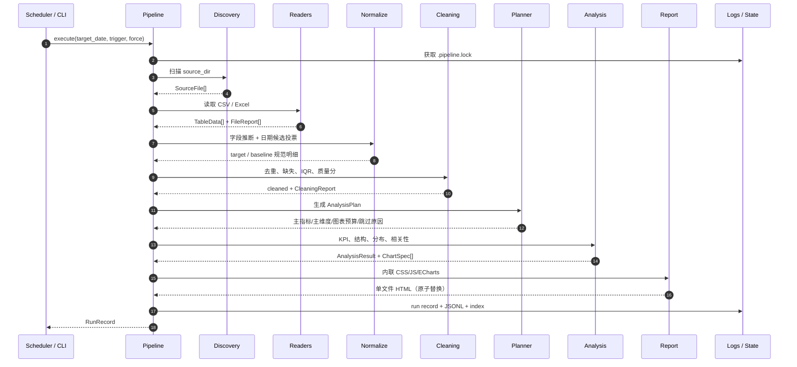

# 架构说明

## 1. 目标与约束

InsightFlow 的目标不是“跑一次分析”，而是把一条**每天可重复执行**的数据处理服务做完整：

1. 输入是不可控的本地 Excel / CSV；
2. 触发可以来自人工，也可以来自每日 09:30 的调度；
3. 任何单个坏文件都不能拖垮整批任务；
4. 输出必须是一个可离线分发的单文件 HTML；
5. 每个结论都能回溯到清洗后明细和明确口径；
6. 失败必须留下结构化记录，便于第二天排障。

架构围绕这些约束做了三件事：**边界收敛、确定性计算、可审计输出**。

---

## 2. 运行时序



---

## 3. 模块边界

| 模块 | 职责 | 不负责 |
|---|---|---|
| `discovery.py` | 目录扫描、扩展名过滤、临时文件排除、指纹 | 读文件内容 |
| `readers.py` | 编码/分隔符/表头、CSV/Excel 解析、文件级错误 | 字段语义、业务口径 |
| `schema.py` | 表头别名、类型/角色推断、单位识别、数据画像 | 日期筛选、清洗 |
| `normalize.py` | 日期候选投票、目标日/基准日筛选、规范列、来源列 | 缺失填补、去重 |
| `cleaning.py` | 去重、缺失、IQR、质量分、清洗审计 | 业务分析 |
| `planner.py` | 主指标/主维度、候选分析、预算、跳过原因 | 实际计算 |
| `analysis.py` | KPI、聚合、Pareto、分布、相关性、洞察、图表数据 | HTML 渲染 |
| `report.py` | 模板、图表配置、HTML 转义、离线资源内联 | 文件读取 |
| `pipeline.py` | 编排、锁、幂等、产物、日志、异常边界 | 具体算法 |
| `services.py` | 只读预览：扫描 + 读取 + 目标/基准日命中，供 CLI 与 GUI 共用 | 写报告、加锁、幂等索引 |
| `scheduler.py` | Windows Task XML / schtasks / daemon / 补跑 | 分析逻辑 |
| `logging_setup.py` | 轮转文本日志 + JSONL + 最近一次记录 | 业务状态 |
| `gui/` | 桌面操作端：主窗口与四分区、后台线程与消息队列、锁定环境自检 | 任何业务计算（一律调用 `pipeline.execute()`） |

---

## 4. 数据契约

### 4.1 读取层

`SourceFile` → `TableData[]` → `FileReport[]`：

- `TableData` 保留原始表头、表头行号、编码、分隔符、行数、截断标记、修复表头计数；
- 读取函数同时返回工作簿的 `total_sheets`；`FileReport` 记录 `read / no_target / skipped / error`，并给出 `sheets_read / sheets_skipped`（全 Sheet 失败也会保留正确跳过数）；
- 所有异常都转换为 `FileIssue(code, message, severity, file, sheet)`，而不是向上抛。

### 4.2 规范字段

`Normalize` 输出固定以双下划线开头的血缘/时间列：

```text
__date, __timestamp, __hour, __period, __record,
__source_file, __source_sheet, __source_row
```

`__source_row` 是**物理行号**：CSV 使用 `csv.reader.line_num`，Excel 使用 Sheet 行号。它在日期筛选、去重、排序后仍然保留，因此报告里的“行 N”可以直接回到原始文件核对。读取层用隐藏列承载该值，`schema` 明确跳过所有 `__` 前缀列。

业务列使用 canonical key：

```text
revenue, orders, customers, new_customers, cost, profit, price, discount,
region, category, channel, store, product, brand, salesperson,
customer_id, order_id, ...
```

这样不同文件使用「销售额 / 销售金额 / revenue」时，可以在同一张分析表中对齐，而不用在分析层写一堆 if/else。

### 4.3 日期候选投票

一个工作簿可能同时有「订单日期」「发货日期」「创建日期」。读取层不做硬编码，而是：

1. 所有日期/时间列进入候选；
2. 对每个候选解析出 `date`；
3. 统计命中目标日 / 基准日的行数；
4. 以 `命中数 → 基准命中 → 解析率 → 表头优先级` 投票；
5. 选中的列写入运行元数据 `date_columns`。

这能处理“日期列很多，但只有一列真正对应本期”的常见导出。`03/04/2026` 这类日/月都 ≤12 的歧义值默认按 **月/日/年** 解析（2026-03-04）；可通过 `date_order: month_first / day_first / error` 切换，检测到歧义值会写 warning。跨区域数据建议使用 `YYYY-MM-DD`。

字段推断对 `毛利率 / 利润率 / 占比 / 平均 / 非销售额` 等**不可相加**表头做了防护：它们不会映射到 revenue/profit 等金额指标后被 SUM；率类字段使用 `AVG` 聚合，主指标为率时占比/帕累托禁用，避免“数字悄悄错掉”。

### 4.4 计划与图表

`AnalysisPlan` 是纯数据对象，包含：

- `primary_metric` / `primary_dimension` / `secondary_dimension`；
- 每个 `AnalysisStep` 的 `enabled` 与 `skip_reason`；
- `MetricDefinition`（公式、单位、聚合方式）；
- `profile`（字段覆盖率、基数、小时数）。

`AnalysisResult` 中的 `ChartSpec` 只携带**数据 + 元信息**，不携带 HTML/JS。渲染层再统一组装 ECharts option，避免分析逻辑和前端耦合。

---

## 5. 并发、幂等与恢复

### 5.1 文件锁

- 路径：`state/.pipeline.lock`；
- 创建：`os.open(..., O_CREAT | O_EXCL)`；
- 内容：PID、启动时间、当前目录；
- 过期：默认 150 分钟（略高于任务计划 2 小时超时），过期自动清理；
- 冲突：后到运行状态 `skipped`，不阻塞、不重试、不写报告。

### 5.2 幂等

- 指纹：源文件相对路径 + 大小 + `mtime_ns` 的 SHA-256；
- 索引：`state/index.json`，按目标日期记录指纹、报告路径、run id；
- 同指纹且报告存在：状态 `skipped`，复用报告；
- `--force` 或文件变化：重新计算。

### 5.3 原子写入

报告、JSON、索引都先写同目录临时文件，再 `os.replace`。这样即使进程在写报告时被杀，也不会留下一个“看似存在但打不开”的 HTML。

---

## 6. 离线报告

`report.py` 读取包内 `assets/echarts.min.js`，直接嵌入 `<script>`；CSS 内联在模板中；没有 `<script src>`、`<link rel="stylesheet">`、`fetch()`。

图表数据通过 JSON 注入，图表下方的数据表由 Python 渲染，因此：

- JavaScript 正常：交互图表 + 表格；
- JavaScript 被禁用：仍有完整表格；
- 打印：隐藏导航和按钮，卡片避免跨页断裂。

安全处理：

- 所有源数据经 `html.escape` 进入 DOM；
- JSON 注入时转义 `<`、`>`、`&`，防止 `</script>` 截断；
- ECharts 库本身也做 `</script` 替换。

---

## 7. 调度设计

### Windows Task Scheduler

- `schedule install` 写 UTF-16 XML 到 `state/<task>.xml`；
- 调用 `schtasks /Create /XML ... /F`；
- 触发器：每日固定 `HH:MM`；
- `MultipleInstancesPolicy=IgnoreNew`：计划任务层再加一道并发保护；
- `StartWhenAvailable=true`：休眠错过后恢复补跑；
- 动作：`powershell.exe -File scripts/run_scheduled.ps1`。

### 内置 daemon

- 计算下一次触发时间；
- 30 秒轮询；
- 启动时在 `grace_minutes` 内补跑当天错过的一次；
- 状态写 `state/scheduler_state.json`；
- 不依赖 APScheduler / cron。

---

## 8. 测试策略

- **纯函数优先**：日期、数字、乱码、表头、分隔符都有独立测试；
- **端到端**：临时目录生成 CSV，跑完整 `execute`，断言报告、产物、幂等、锁、HTML 转义；
- **无外部服务**：测试不需要浏览器、数据库、网络；
- **可重复**：演示数据固定随机种子；日期由参数注入。

---

## 9. 扩展点

| 需求 | 建议改动 |
|---|---|
| 多日趋势 / 周报 | 扩展 `normalize` 读取区间，新增 `trend` 步骤；不要改读取层 |
| 邮件/企微通知 | 新增 `notifier.py`，在 `pipeline` 成功后调用，失败不影响报告 |
| 数据库源 | 新增 reader 返回 `TableData`，保持 schema/cleaning/analysis 不变 |
| 更多图表 | 在 `analysis.py` 增加 `ChartSpec.data`，在模板 `buildOption` 增加分支 |
| 自定义指标 | 扩展 `FIELD_META` / `MetricDefinition`，并补测试 |
| 多语言 | 抽出 `labels.py`；报告模板目前以中文为主 |
| 对象存储归档 | 在 `pipeline` 的产物段增加 uploader，保持本地文件为 source of truth |

---

## 10. 关键设计取舍

1. **先做可靠的单机日更，而不是分布式调度**：本地文件场景下，单进程 + 文件锁 + 幂等足够，运维成本最低。
2. **规则引擎优先于 LLM**：日更报告需要可复现、可解释、零 token 成本；LLM 更适合作为后续“归因建议”增强，而不是计算核心。
3. **报告内嵌数据表**：图表是沟通层，表格才是审计层；两者必须来自同一份 `ChartSpec.data`。
4. **只标记异常，不删除异常**：日更场景下大额订单是信号，不是噪声。

---

## 11. 桌面操作端（GUI）

操作端是**编排与展示层**，让不接触命令行的操作员完成「放数据 → 运行 → 取报告」。核心流水线在无 GUI 时仍可独立运行。

```text
gui/__main__.py   入口：stderr 兜底、加载配置、DPI、启动门禁
gui/app.py        主窗口：顶部状态条 + 四分区 + 底部工具条；after() 轮询消息
gui/worker.py     单工作线程 + queue.Queue；4 种消息（started/progress/done/failed）
gui/services.py   唯一允许 import 核心的 GUI 模块：预览、文件清单、锁状态、执行、
                  质量区（读 metrics.json + cleaned_data 标记）、历史、日期口径持久化
gui/envcheck.py   锁定环境比对（读 requirements.lock.txt，importlib.metadata 取版本）
```

进度观察：`pipeline.execute(..., on_step=...)` 是默认关闭的钩子（`ContextVar` 传递，
观察者异常被吞掉），GUI 用它把核心步骤映射成 读取 → 清洗 → 分析 → 出报告 四段；
CLI 与计划任务不传该参数，行为逐字节不变。

硬规则：

- `app.py` / `worker.py` **不 import** `pipeline`、`readers`、`analysis`、`pandas`；业务动作只能经由后续新增的 `gui/services.py` 调用 `pipeline.execute()`；
- Tk 控件只在主线程操作，工作线程只经队列回消息（Tk 非线程安全）；
- 环境与锁定清单不一致时，启动门禁**默认阻断**（fail-closed），不静默放行；
- `python -m insightflow.gui` 与 `启动操作端.bat` 均可启动；CLI 与计划任务不受影响。

