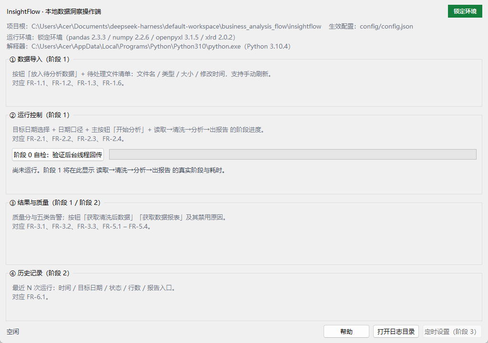

# 阶段 0 实施方案与文件清单 · GUI 工程地基

> 依据：《InsightFlow 操作端前端要求书》《InsightFlow 操作端分阶段开发任务书》
> 阶段目标：搭好 GUI 工程骨架与启动方式，**不实现任何业务功能**
> 状态：待评审（评审通过后才创建分支 `feat/gui-phase0` 并开始编码）
> 本文件同时作为阶段 0 交付附带文档：变更清单 → 自测输出 → 锁定环境 → 已知遗留

---

## 0. 一句话结论

阶段 0 交付 **6 个新文件 + 1 个启动器 + 1 个测试文件**（约 700 行含注释），建立一个"主线程只碰界面、工作线程只碰任务、两者只通过队列传消息"的空壳窗口，并让 `启动操作端.bat` 一键打开。**全程不 import `pipeline`、不调用 `execute()`、不改任何核心模块。**

---

## 1. 阶段目标与边界

### 1.1 任务书原文要求（逐条对应）

| 任务书条目 | 本方案落点 |
|---|---|
| 新增 GUI 包（`src/insightflow/gui/`），与核心分层；选定 tkinter | `gui/{__init__,__main__,app,worker,envcheck}.py`，零新增依赖 |
| 可启动的最小主窗口，按四分区布局占位 | `app.py`：顶部状态条 + ①导入 ②运行 ③结果与质量 ④历史 + 底部工具条 |
| 后台工作线程 + 主线程回调/消息队列 | `worker.py`：单工作线程 + `queue.Queue` + `after()` 轮询，4 种消息 |
| 双击启动入口（`启动操作端.bat`，激活锁定 venv 后启动） | `启动操作端.bat`：优先 `.venv`，缺失则回退系统 Python，全 ASCII 内容 |
| 接入现有日志，GUI 与 CLI 共用配置与目录 | `configure_logging(settings)` 复用；顶部显示生效配置文件与目录 |

### 1.2 本阶段明确**不做**（防止半成品被当成 MVP）

- 不读数据源、不列清单、不打开资源管理器（FR-1.x）
- 不调用 `execute()`、不做进度阶段、不管理锁（FR-2.x）
- 不读 `metrics.json`、不展示质量分与告警（FR-3.x / FR-5.x）
- 不读写 `config.json`、不做日期口径选择（FR-4.x）
- 不读 `runs.jsonl`、不做历史列表（FR-6.x）
- 不做定时任务 UI（FR-7.x）；不做向导与日志包（FR-8.x）
- 不新增第三方依赖（tkinter 属标准库；**不引入 customtkinter**）

> 阶段 0 的验收物只有一件事：**双击能开窗、线程能回话、关窗能干净退出、核心 41 测试不受影响**。

---

## 2. 现状核查（已在本机实测，非推断）

| 项 | 实测结果 | 对方案的影响 |
|---|---|---|
| Python | 3.10.4（`C:\Users\Acer\AppData\Local\Programs\Python\Python310\python.exe`） | 与 `requires-python >=3.10` 一致；`X | None` 语法可用 |
| tkinter | 8.6，可 import | 选型成立，无需安装 |
| pandas / numpy | **2.3.3 / 2.2.6** | 与 `requirements.lock.txt` 完全一致（系统解释器已是锁定版本） |
| `.venv` | **不存在** | 启动器必须"优先 venv、缺失回退"，不能硬编码 venv 路径 |
| GUI 代码 | `src/insightflow/` 下无 `gui/`，全仓库 0 处 GUI/tkinter 字样 | 全新目录，无历史包袱 |
| 测试 | 41 个（`def test_` 计数与文档一致） | 新增后应为 49±1，CI 无需改配置即可发现 |
| CI | `windows-latest` + Py3.10 + lock + `unittest discover -s tests` | 新测试自动纳入；**不改 workflow** |
| 现有启动器 | `run.bat` / `run.ps1` 均为 `python -m insightflow`（CLI） | GUI 启动器独立新建，不动旧文件 |
| `configure_logging` | 幂等（按 log_dir 判重），挂 `RotatingFileHandler` + **stderr** 控制台 handler | GUI 启动时接管 `sys.stderr`，避免 `pythonw` 下 None 崩溃 |
| `find_project_root` | 环境变量 → cwd 上溯 → **包根回退**（`config.py` 的 `parents[2]`） | 只要 `PYTHONPATH=src`，从任何 cwd 启动都能定位项目根 |
| `settings.config_path` | 缺 `config.json` 时会回退到 `config.example.json` | 顶部状态条必须显示**实际生效**的配置文件 |
| `RunRecord.report_path` | 相对项目根的路径 | 阶段 1 打开报告时需 `project_root / report_path`（本阶段不涉及，先记录） |
| `acceptance_data/` | 未跟踪（`git status` 显示 `??`） | 阶段 2 DoD 的固定夹具，建议阶段 0 一并入库 |

---

## 3. 设计决策（D1–D9）

**D1　用 tkinter，不用 customtkinter。**
理由：零依赖、离线、`requirements.lock.txt` 不动（引 customtkinter 需改 lock 并重新验证，违反"不引入未锁定依赖"）。观感靠 `ttk.Style` + 统一的字体/间距常量解决，足以满足 1366×768。

**D2　分层：`app.py` 不 import 核心模块。**
硬规则（写进代码注释，评审据此检查）：

| 层 | 允许 import | 禁止 |
|---|---|---|
| `gui/app.py`、`gui/worker.py` | `tkinter`、`gui.*`、`config`（仅 `Settings` 类型）、`logging_setup` | `pipeline` / `readers` / `analysis` / `pandas` |
| `gui/envcheck.py` | `importlib.metadata`、`pathlib` | 任何核心模块、tkinter |
| `gui/services.py`（**阶段 1 才建**） | `pipeline`、`readers`、`discovery`、`logging_setup` | tkinter |

这样"业务计算只走 `execute()`"在结构上就成立，而不是靠自觉。

**D3　线程模型：1 个工作线程 + 1 个消息队列，`daemon=True`。**
- 任务签名固定为 `task(progress) -> Any`；任务内部**只能**通过 `progress` 上报，不许碰控件；
- 主线程用 `root.after(80, self._pump)` 消费队列（约 12 帧/秒，足够进度刷新且不空转 CPU）；
- `submit()` 在忙碌时返回 `False`，不排队、不并发——**这条直接对应 FR-2.4 的并发保护**；
- `shutdown()` 置取消位 + `join(2s)`，窗口关闭不残留进程（对应 DoD"关闭窗口进程干净退出"）。

**D4　消息协议冻结（4 种 kind，阶段 1–4 只增不改）。**

| kind | payload | 界面动作 |
|---|---|---|
| `started` | `{label}` | 显示"正在执行…"、禁用主按钮 |
| `progress` | `{text, current?, total?}` | 更新阶段文案 + 进度条（`None` 时为不确定态） |
| `done` | `{result}` | 恢复按钮、展示结果摘要（阶段 1 接 `RunRecord`） |
| `failed` | `{message, error_type}` | 友好提示（**不含 traceback**，traceback 只进日志） |

**D5　启动器用 `python.exe`（带控制台），不用 `pythonw.exe`。**
理由：阶段 0 需要排障可见性；`pythonw` 下 stderr 为 `None`，日志控制台 handler 会静默报错。代价是窗口后面有一个黑框——记为**已知遗留**，由阶段 4 打包（GUI 可执行文件）消除。同时在 GUI 侧做 `sys.stderr is None → devnull` 兜底，提前为 `pythonw` 铺路。

**D6　`.bat` 内容全 ASCII，文件名保留中文。**
cmd 解析 `.bat` 用当前代码页，UTF-8 中文注释/回显极易乱码；中文文件名由 NTFS 承载、双击不受影响。故：文件名 `启动操作端.bat`，内容中 `echo` 一律英文 + 先 `chcp 65001`。

**D7　启动器优先锁定环境，缺失则回退并**明示**。**

```bat
set "PY=python"
if exist "%~dp0.venv\Scripts\python.exe" set "PY=%~dp0.venv\Scripts\python.exe"
```

不复制 `run.bat` 的 `pushd` 之外逻辑；`PYTHONPATH=%~dp0src`、`PYTHONIOENCODING=utf-8` 与现有一致。退出码非 0 时 `pause` 并提示看 `logs\insightflow.log`（非技术用户至少不会"闪退无感"）。

**D8　顶部"环境状态"徽标在本阶段就做（约 70 行，纯函数可测）。**
要求书 §3 顶部区明确要"运行环境状态（正常·锁定环境）"。实现为 `envcheck.check_environment()`：解析 `requirements.lock.txt` 的 `pandas==/numpy==`，用 `importlib.metadata.version()` 比对，返回 `ok / mismatch / unknown`（**不 import pandas，避免拖慢启动 1–2 秒**）。阶段 0 做掉，阶段 2 不必返工。

**D9　测试策略：非 GUI 逻辑必测，GUI 冒烟在无显示环境自动 skip。**

- worker / envcheck 是纯逻辑 → 常规单测，CI 必过；
- `Tk()` 冒烟测试用 `skipUnless` 包裹，`TclError`（无桌面会话）即跳过并给出原因，**不让 CI 因环境失败**；本地必须跑过（自测输出会附）。

---

## 4. 目录结构与文件清单

```text
insightflow/
├─ 启动操作端.bat                      [新增] 双击入口
├─ src/insightflow/gui/                [新增目录]
│  ├─ __init__.py                      [新增] 包说明 + launch(settings) 导出
│  ├─ __main__.py                      [新增] python -m insightflow.gui 入口
│  ├─ app.py                           [新增] 主窗口：四分区占位 + 状态条 + 轮询泵
│  ├─ worker.py                        [新增] 后台线程 + 消息队列 + 进度对象
│  └─ envcheck.py                       [新增] 锁定环境版本比对（纯函数）
├─ tests/test_gui_shell.py             [新增] 9 个测试
├─ examples/acceptance/                [新增] 验收夹具（评审 B2）
│  ├─ 01_主样本_干净.csv
│  └─ 02_边界样本_含问题.csv
├─ docs/images/gui-stage0.png          [新增] 启动截图
├─ docs/images/gui-stage0-selfcheck.png [新增] 自检完成截图
├─ docs/gui-phase0-plan.md             [新增] 本文件（方案 + 自测记录）
├─ docs/architecture.md                [修改] §3 模块边界表加 1 行 GUI 层；末尾加 §11 GUI 分层
└─ （不动）其余 58 个已跟踪文件：pipeline/readers/analysis/report/cli/scheduler、config、CI workflow、requirements*.txt、pyproject.toml
```

### 4.1 逐文件职责与规模

| # | 文件 | 职责 | 预估行数 | 依赖 |
|---|---|---|---:|---|
| 1 | `gui/__init__.py` | docstring；`from .app import InsightFlowApp`；`launch(settings=None) -> int` | ~20 | app |
| 2 | `gui/__main__.py` | stderr 兜底 → `load_settings` → `configure_logging` → DPI → `mainloop` → 异常友好化 | ~65 | config, logging_setup, app |
| 3 | `gui/worker.py` | `Message`/`Progress`/`BackgroundWorker`（submit/pump/cancel/shutdown） | ~140 | 标准库 |
| 4 | `gui/app.py` | `InsightFlowApp(tk.Tk)`：`_build_header/_build_zones/_build_footer`、`_pump`、`_on_close`、`_run_selfcheck` | ~230 | worker, envcheck, ttk |
| 5 | `gui/envcheck.py` | `EnvStatus` dataclass + `check_environment(lock_path)` 解析比对 | ~80 | 标准库 |
| 6 | `启动操作端.bat` | 环境准备 + 启动 + 失败暂停 | ~25 | — |
| 7 | `tests/test_gui_shell.py` | 9 个用例（见 §6） | ~200 | worker, envcheck, app |
| 8 | `docs/gui-phase0-plan.md` | 本方案，自测后追加实测输出 | 本文件 | — |
| 9 | `docs/architecture.md` | 文档与代码同步（分层规则） | +10 | — |

合计新增代码约 **730 行**（含中文注释与空行）。

### 4.2 四分区占位内容（明确"待实现"，防止误用）

| 分区 | 阶段 0 显示 | 阶段 1 承接 |
|---|---|---|
| 顶部状态条 | 标题 · 项目根路径 · 配置文件 · 环境徽标（锁定/偏离） | 加"已有任务执行中"状态 |
| ① 数据导入 | 灰字"阶段 1：放入待分析数据 + 待处理文件清单（FR-1.1/1.2/1.3/1.6）" | 文件清单 Treeview |
| ② 运行控制 | 灰字"阶段 1：目标日期 + 开始分析 + 进度（FR-2.1~2.4）" | 日期控件 + 进度条 |
| ③ 结果与质量 | 灰字"阶段 2：质量分与五类告警；按钮 2/3 在阶段 1（FR-3.x/5.x）" | 质量卡片 + 告警表 |
| ④ 历史记录 | 灰字"阶段 2：最近 N 次运行（FR-6.1）" | 历史列表 |
| 底部工具条 | 帮助 / 日志（点击打开 `logs\` 目录，本阶段即可用）/ 定时设置（禁用） | 向导、日志包、调度 |

底部"日志"按钮是阶段 0 唯一真实可用的功能（`os.startfile(log_dir)`），既满足"提供日志入口"，又不越界。

---

## 5. 关键接口骨架

### 5.1 `worker.py`（阶段 0 的核心）

```python
MSG_STARTED, MSG_PROGRESS, MSG_DONE, MSG_FAILED = "started", "progress", "done", "failed"

@dataclass
class Message:
    kind: str
    payload: dict[str, Any] = field(default_factory=dict)

class TaskCancelled(Exception):
    """任务在协作式取消点主动退出。"""

class Progress:
    def stage(self, text: str, *, current: int | None = None, total: int | None = None) -> None: ...
    def log(self, text: str) -> None: ...
    def check_cancelled(self) -> None:  # 抛 TaskCancelled，阶段 1 的"可取消"靠它

class BackgroundWorker:
    def __init__(self) -> None: ...
    @property
    def busy(self) -> bool: ...
    def submit(self, task: Callable[[Progress], Any], *, label: str = "") -> bool: ...
    def pump(self, limit: int = 50) -> list[Message]: ...
    def cancel(self) -> None: ...
    def shutdown(self, timeout: float = 2.0) -> None: ...
```

实现要点（评审关注点）：
- 线程 `daemon=True`；`submit` 用 `threading.Lock` 保护 `busy` 状态，避免连点两次起两个线程；
- `pump()` 只做 `get_nowait()` 循环，**永不阻塞**（否则界面卡死）；
- 任务抛任何异常都在工作线程内捕获，`traceback.format_exc()` 写日志，队列只放 `{message, error_type}`——这是"不暴露 traceback"的第一道闸。

### 5.2 `app.py` 结构

```python
class InsightFlowApp(tk.Tk):
    def __init__(self, settings: Settings) -> None:
        super().__init__()
        self.settings = settings
        self.worker = BackgroundWorker()
        self.title(f"{settings.app_name} 操作端")
        self.minsize(960, 640)
        self.geometry("1024x720")
        self._build_header(); self._build_zones(); self._build_footer()
        self.protocol("WM_DELETE_WINDOW", self._on_close)
        self.after(80, self._pump)
```

- `_pump()`：取消息 → `started` 禁用"自检"按钮 / `progress` 更新文案与进度条 / `done` 恢复 + 弹提示 / `failed` 弹友好框；末尾再 `after(80, ...)`；
- `_on_close()`：`worker.shutdown()` → `destroy()`；
- `_run_selfcheck()`：提交一个 3 阶段、每阶段 0.6s 的模拟任务（DoD 第 2 条的可视证据），按钮标注"阶段 0 自检（阶段 1 移除）"。

### 5.3 `envcheck.py` 契约（纯函数，可单测）

```python
@dataclass(frozen=True)
class EnvStatus:
    state: str          # "ok" | "mismatch" | "unknown"
    detail: str         # 人话："锁定环境（pandas 2.3.3 / numpy 2.2.6）"
    expected: dict[str, str]
    actual: dict[str, str]

def check_environment(lock_path: Path, packages: tuple[str, ...] = ("pandas", "numpy")) -> EnvStatus: ...
```

### 5.4 `启动操作端.bat`

```bat
@echo off
setlocal
chcp 65001 >nul
set "ROOT=%~dp0"
set "PYTHONPATH=%ROOT%src"
set "PYTHONIOENCODING=utf-8"
set "PY=python"
if exist "%ROOT%.venv\Scripts\python.exe" set "PY=%ROOT%.venv\Scripts\python.exe"
pushd "%ROOT%"
"%PY%" -m insightflow.gui
set "CODE=%ERRORLEVEL%"
if not "%CODE%"=="0" (
  echo InsightFlow GUI exited with code %CODE%.
  echo See logs\insightflow.log for details.
  pause
)
popd
exit /b %CODE%
```

---

## 6. 测试清单（`tests/test_gui_shell.py`，9 个）

| # | 用例 | 断言 | 是否需要 Tk |
|---|---|---|---|
| 1 | `test_worker_emits_started_progress_done` | 消息顺序 = started → progress×2 → done；`busy` 回落 False | 否 |
| 2 | `test_worker_rejects_concurrent_submit` | 任务运行中再 `submit` 返回 `False`（FR-2.4 的底层保证） | 否 |
| 3 | `test_worker_reports_failure_without_traceback` | `failed.payload["message"]` 有值且**不含 `Traceback`**；`error_type` 正确 | 否 |
| 4 | `test_progress_cancel_raises_task_cancelled` | `cancel()` 后 `check_cancelled()` 抛 `TaskCancelled` | 否 |
| 5 | `test_pump_never_blocks_and_returns_empty` | 空队列 `pump()` 立即返回 `[]` | 否 |
| 6 | `test_shutdown_joins_worker` | `shutdown()` 后线程 `is_alive()` 为 False | 否 |
| 7 | `test_environment_check_matches_lock` | 读真实 `requirements.lock.txt`，state=`ok`，版本字符串含 2.3.3 | 否 |
| 8 | `test_environment_check_detects_mismatch` | 临时 lock 写 `pandas==0.0.1` → state=`mismatch` | 否 |
| 9 | `test_window_builds_four_zones_and_closes_clean` | 四个 LabelFrame 存在；`_on_close()` 后 worker 不在运行 | **是（skip 兜底）** |

第 9 条写法：`try: app = InsightFlowApp(settings) except tk.TclError: self.skipTest("无可用桌面会话")`，`finally` 里 `app.destroy()`。防 CI 抖动，也防测试残留窗口。

---

## 7. DoD 对照表

| 任务书 DoD | 验证方式 | 证据形式 |
|---|---|---|
| 双击 `.bat` 能打开主窗口；关闭窗口进程干净退出 | 手动双击 + 用例 6/9 | 截图 + 自测输出 |
| 后台线程框架可向界面回传模拟消息；界面不阻塞 | 点"阶段 0 自检"，观察 3 阶段进度与窗口可拖动 + 用例 1–6 | 截图 + 测试输出 |
| CLI 与 41 测试不受影响，全部通过 | `python -m unittest discover -s tests -v`；`.\run.ps1 scan --date 2026-11-07` 冒烟 | 全量输出粘贴入交付说明 |

**通过判定**：三条全绿 + 工作区只剩预期新增文件 + 未改任何核心模块（`git diff --stat` 可证）。

---

## 8. 风险与对策

| # | 风险 | 影响 | 对策 |
|---|---|---|---|
| R1 | CI 的 Windows runner 无桌面会话，`Tk()` 抛 `TclError` | CI 误红 | 用例 9 用 `skipUnless` + `except TclError: skipTest`；CI 只保证非 GUI 逻辑 |
| R2 | `pythonw` 下 `sys.stderr is None`，`configure_logging` 的控制台 handler 报错 | 日志噪音/丢失 | `__main__` 中 `sys.stderr = open(os.devnull, "w")` 兜底（不改 `logging_setup`） |
| R3 | 高 DPI 下字体模糊、控件错位 | 不满足 NFR-3 视觉要求 | `__main__` 里 `SetProcessDpiAwareness(1)`，失败静默；字体统一 `Microsoft YaHei UI 10` |
| R4 | `.bat` 中文导致乱码/解析失败 | 双击不可用 | 内容全 ASCII + `chcp 65001`；中文只在文件名 |
| R5 | 本机无 `.venv`，与"激活锁定 venv"表述不符 | NFR-5 存疑 | 启动器回退 + 顶部徽标显示"未使用锁定环境"；是否建 venv 见 §10 待决 A |
| R6 | 后台线程误碰控件（Tk 非线程安全） | 随机崩溃 | 只允许经队列；`app.py` 中 `worker` 之外不出现 `threading`；评审红线 |
| R7 | 关窗时线程仍在跑 | 进程残留、锁不释放 | `daemon=True` + `shutdown(join 2s)`；用例 6/9 守护 |
| R8 | 与 CLI 抢日志 handler | 日志重复/丢行 | 复用幂等的 `configure_logging`，一个进程只调一次 |
| R9 | `acceptance_data/` 一直未跟踪 | 阶段 2 DoD 缺夹具 | 阶段 0 一并入库（见 §10 待决 B） |

---

## 9. 锁定环境与自测命令

运行环境（阶段 0 自测即用此环境）：

```text
Python 3.10.4  ·  Windows  ·  tkinter 8.6
pandas 2.3.3  ·  numpy 2.2.6      (= requirements.lock.txt)
无 .venv；PYTHONPATH=src
```

```powershell
# 1) 全量测试（应 41 + 9 = 50 条，全 OK）
$env:PYTHONPATH="src"; python -m unittest discover -s tests -v

# 2) 仅 GUI 骨架
$env:PYTHONPATH="src"; python -m unittest tests.test_gui_shell -v

# 3) 启动冒烟（窗口出现即算通过，Ctrl+C 或关窗退出）
$env:PYTHONPATH="src"; python -m insightflow.gui

# 4) 回归：核心 CLI 不受影响
.\run.ps1 scan --date 2026-11-07
```

---

## 10. 待评审确认（已裁定，2026-11-08）

| 项 | 裁定 | 落实位置 |
|---|---|---|
| A 锁定环境 | **A1**（沿用系统 Python310，不建 venv）+ 2 条硬条件 | 硬条件 1 → 启动门禁 fail-closed（§13.1）；硬条件 2 → 解释器路径在顶部可见，阶段 4 封装依赖 |
| B 验收夹具 | **B2**（移到 `examples/acceptance/`，并补 `01_主样本_干净.csv`） | `examples/acceptance/01、02` 两个文件已入库 |
| C 窗口尺寸 | **C1**（1024×720，minsize 960×640） | `app.py` 构造函数 + 测试断言 |

原三问的备选方案（A2 / B1 / B3 / C2）不再执行。

---

## 11. 提交与评审材料

- 分支：`feat/gui-phase0`（从 `main` `6f75f33` 切出；验收夹具已按 B2 先行入库，再提交 GUI 骨架）
- 提交信息：`feat(gui): scaffold desktop shell, background worker and launcher`
- 交付附件（按任务书要求，缺一不可）：
  1. 变更文件清单（本文件 §4，实测后补 `git diff --stat`）
  2. 自测命令与**完整输出**（41+9 全绿、scan 冒烟、启动截图）
  3. 锁定环境版本（本文件 §9）
  4. 已知遗留：控制台黑框（阶段 4 消除）、四分区均为占位、无 `.venv`（若选 A1）

## 12. 阶段 1 开工前必须先做的一件事（提醒，不在阶段 0 范围）

`FR-2.6` 的"只预览不生成"当前没有可复用函数——`scan` 的全部逻辑关在 `cli._cmd_scan()` 里（含打印）。阶段 1 若直接照搬会在 GUI 里复制一遍读取逻辑，违反"不重写核心"。建议阶段 1 第一步先做**纯重构**：把 `_cmd_scan()` 抽出为 `services.preview()`（返回结构化字典），CLI 改为调用它并只负责打印；补一条"CLI 输出与重构前逐字节一致"的回归测试，再开始做界面。

---

## 13. 执行记录（评审后，2026-11-08）

### 13.1 评审意见逐条落实

| 评审项 | 落实方式 | 证据 |
|---|---|---|
| A 硬条件 1：环境偏离必须醒目阻断 | `envcheck.gate_message()` 产出阻断文案；`__main__` 在 `mainloop` 前调用 `confirm_environment()`，mismatch / unknown 均弹「环境不可信」并要求确认；对话框 `default="no"`，且 TclError 时**返回 False（fail-closed）**；同时窗口顶部显示红色横幅与红色徽标 | 测试 `test_environment_check_blocks_drift_and_unknown` + 窗口测试内的门禁断言 |
| A 硬条件 2：解释器实际路径可见 + 阶段 4 封装依赖 | 顶部第 3 行常显 `解释器：<绝对路径>（Python 3.10.4）`；阶段 4 打包须封装依赖（写入路线图） | 截图  |
| B：夹具移到 `examples/acceptance/` 并补 01 | 已建 `examples/acceptance/01_主样本_干净.csv`（10 行、单日、无缺失/无重复/无越界）与 `02_边界样本_含问题.csv` | 两文件已入库 |
| C：1024×720 / minsize 960×640 | 构造函数设定；window 测试断言 `minsize()` 与分区标题 | `test_window_builds_four_zones_and_closes_clean` |
| 补强 2：stderr 兜底最小化 | 仅 `sys.stderr is None` 时重定向到 devnull；`python.exe` 下保留控制台输出 | `gui/__main__._ensure_standard_streams` |
| 补强 3：测试数量自证 | **41 + 9 = 50，全 OK**（实测 9.7 s） | §13.2 |
| 补强 4：核心零改动 | 仅新增 `gui/`、`tests/`、bat、docs、examples；`pipeline/readers/analysis/report/cli/scheduler/models/config` 均未改动 | `git diff --stat` 中无核心文件 |

### 13.2 自测输出

```text
$env:PYTHONPATH="src"; python -m unittest discover -s tests
..................................................
----------------------------------------------------------------------
Ran 50 tests in 9.667s
OK

$env:PYTHONPATH="src"; python -m unittest tests.test_gui_shell -v
Ran 9 tests in 1.043s
OK

$env:PYTHONPATH="src"; python -m insightflow scan --date 2026-11-07
文件: 7 扫描 / 5 成功读取          （核心 CLI 行为不变）
```

启动器实测：双击 `启动操作端.bat` → 窗口标题 `InsightFlow 操作端` → 关闭窗口后 python 进程数归零（`python-left=0`）。

> 说明：本机 PowerShell 执行策略禁止运行 `run.ps1`（未签名脚本），因此 CLI 回归改用等价的 `python -m insightflow scan`；这与本次改动无关。

### 13.3 自测中发现并修复的真实缺陷

**Tk 变量被工作线程回收导致进程崩溃（`Tcl_AsyncDelete: async handler deleted by the wrong thread`）。**
现象：GUI 测试单独跑通过，与 worker 测试同进程跑时整进程崩溃。根因：Tk 控件之间存在引用环，`destroy()` 后 `StringVar` 仍存活；后续 GC 若发生在工作线程，会在该线程终结 Tcl 解释器 → 进程 abort。
修复：`_on_close()` 先在 UI 线程把 Tcl 变量置空再 `destroy()`；测试在窗口销毁后于主线程 `gc.collect()`。
这正是方案风险 R6（线程与 Tk 安全）的实证，已在代码注释中标明原因，避免后续阶段重犯。

### 13.4 已知遗留

| # | 遗留 | 说明 / 关闭条件 |
|---|---|---|
| 1 | 启动后有一个控制台黑框 | 阶段 4 打包为 GUI 可执行程序后消除 |
| 2 | 四分区均为占位 | 阶段 1 / 2 逐个实现，标题已标 FR 编号 |
| 3 | 未建 `.venv`（评审选 A1） | 启动器保留 `.venv` 优先分支；顶部徽标如实显示实际环境 |
| 4 | 仓库根的 `acceptance_data/` 残留一份旧夹具 | 文件内容已复制到 `examples/acceptance/`；**该目录删除被本机文件策略拒绝（对路径的访问被拒绝）**，故未跟踪、未入库，可在资源管理器中手工删除 |
| 5 | 底部「定时设置」按钮禁用 | 阶段 3（FR-7.1/7.2） |

### 13.5 变更清单（实测）

| 文件 | 行数 | 说明 |
|---|---:|---|
| `src/insightflow/gui/worker.py` | +157 | 线程、队列、进度、取消、错误边界 |
| `src/insightflow/gui/envcheck.py` | +176 | 锁定环境比对、徽标、门禁文案 |
| `src/insightflow/gui/app.py` | +306 | 主窗口四分区、状态条、轮询泵、门禁 |
| `src/insightflow/gui/__main__.py` | +71 | 入口、stderr 兜底、DPI、配置错误提示 |
| `src/insightflow/gui/__init__.py` | +22 | 包导出 |
| `tests/test_gui_shell.py` | +190 | 9 个用例 |
| `启动操作端.bat` | +22 | 双击启动器（ASCII 内容） |
| `docs/architecture.md` | +22 | GUI 分层与硬规则 |
| `docs/gui-phase0-plan.md` | 本文件 | 方案 + 执行记录 |
| `docs/images/gui-stage0*.png` | 2 张 | 启动与自检截图 |
| `examples/acceptance/*.csv` | 2 个 | 验收夹具（01 干净 / 02 边界） |

合计 **14 个文件、+1354 行**（含截图二进制与文档），**0 行改动落在核心模块**。

