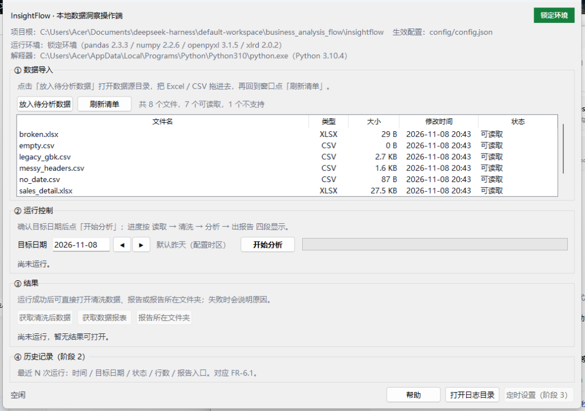
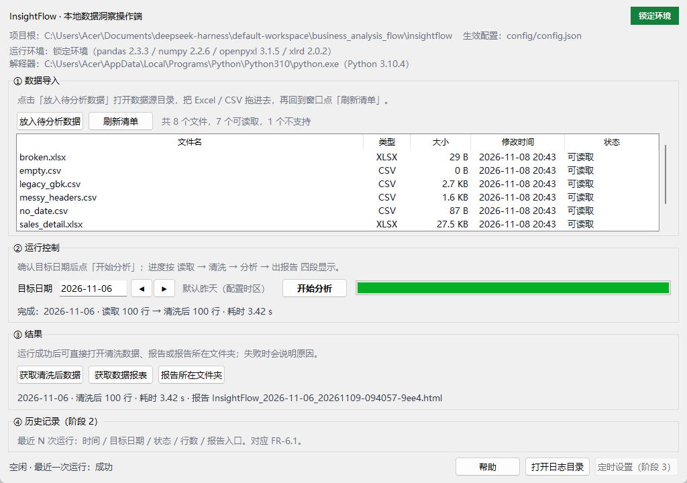

# 阶段 1 交付记录

> 依据：《InsightFlow 操作端前端要求书》《操作端分阶段开发任务书》
> 阶段 1 目标：无编程基础者能独立跑通「放数据 → 运行 → 取报告」，结果与命令行完全一致。
> 本文件按步骤追加记录；当前进度：**第 0 步（纯重构）已完成**。

---

## 第 0 步：把 `cli._cmd_scan()` 抽成 `services.preview()`（纯重构，无行为变化）

评审要求：先做纯重构，CLI 只负责打印，并配「重构前后输出逐字节一致」的回归测试；确认没有复制逻辑后再做界面。

### 1.1 做法

1. **先固化黄金样本，再动代码**。改动前用进程内捕获（`contextlib.redirect_stdout`）把 `scan --date 2026-11-07` 的文本输出与 `--json` 输出各存一份，运行两次确认稳定（`text-stable=True / json-stable=True`），并把本机绝对路径归一化为 `<ROOT>` 后作为夹具：
   - `tests/data/scan_text_golden.txt`
   - `tests/data/scan_json_golden.json`
2. 新增 `src/insightflow/services.py`：`preview(settings, target, source_dir=None) -> PreviewPayload`，把「扫描 → 读取 → 逐表识别字段/日期 → 统计目标日与基准日命中」整段搬进来；**不写报告、不取锁、不碰幂等索引**。
3. `cli._cmd_scan()` 缩减为：解析参数 → 调 `services.preview()` → 打印；表格与提示的排版移到 `_print_preview(payload)`，只读 payload，不再接触 `read_result`。

### 1.2 一个需要说明的设计选择：`PreviewPayload` 是 dict 子类

`preview()` 返回 `PreviewPayload(dict)`：

- **键**与重构前的 payload 完全一致（`target_date / baseline_date / source_dir / files_scanned / files_read / tables / file_errors`），所以 `scan --json` 一个字节都没变；
- **`warnings` 是属性而不是键**，只供文本输出与后续 GUI 使用。若把 warnings 塞进字典，`--json` 的输出就会多一个字段，直接违反「逐字节一致」的契约；
- 附带两个只读属性 `empty_source` / `has_target_rows`，把原先散落在 CLI 里的两个判断收进服务层，GUI 阶段 1 可直接复用。

### 1.3 验证

```text
$env:PYTHONPATH="src"; python -m unittest tests.test_services -v
Ran 5 tests in 2.984s
OK

$env:PYTHONPATH="src"; python -m unittest discover -s tests
Ran 55 tests in 12.253s
OK          （原 50 条 + 重构回归 5 条）
```

| 检查 | 命令 / 方式 | 结果 |
|---|---|---|
| 文本输出逐字节一致 | `test_scan_text_output_matches_golden`（对比改动前快照） | 通过 |
| JSON 输出逐字节一致 | `test_scan_json_output_matches_golden` | 通过 |
| CLI 不再持有读取逻辑 | `Select-String cli.py -Pattern 'read_sources\|detect_schema\|extract_periods\|discover_files'` | **0 处匹配** |
| 退出码语义不变 | `scan --date 2026-11-07` → 0；`scan --date 1999-01-01` → 2 | 符合 |
| 空目录引导 | `test_preview_empty_source_reports_zero_and_cli_exits_2` | 通过（stderr 文案一致） |
| 目录不存在 | `test_preview_missing_source_raises` | 通过 |

> 黄金样本依赖 `examples/raw/` 的演示数据（已入库、阶段 1/2 不再改动）。若将来必须修改该目录，需同步重生成两份夹具并在此记录原因。

### 1.4 为什么这一步是阶段 1 的前置

`FR-2.6`「只预览不生成」要求界面先给出文件数、行数、日期列、告警，再让操作员决定是否运行。重构前这段逻辑锁在 CLI 私有函数里且与 `print` 耦合，GUI 只有两条路：复制一份读取逻辑（违反不变量 1），或调 `print` 出来的字符串（不可用）。现在 `services.preview()` 返回结构化数据，GUI 只是另一个消费者。

### 1.5 未做（刻意留给后续步骤）

- 未改 `detect_schema` 的 `header_scan` 参数（仍用默认 20，与重构前一致）——若要改成 `settings.header_scan_rows` 属于行为变更，必须单独立项并重生成黄金样本；
- 未接 GUI 任何界面；`gui/services.py`（GUI 侧薄封装）随阶段 1 界面功能一起建。

---

## 下一步（阶段 1 界面功能，按任务书顺序）

| 步骤 | 内容 | 对应 FR |
|---|---|---|
| 1 | 数据导入区：打开数据源目录、文件清单（名称/类型/大小/时间）、刷新、不支持类型标灰、空目录禁止空跑 | FR-1.1 / 1.2 / 1.3 / 1.6 |
| 2 | 运行控制：目标日期选择、开始分析（后台线程 + `execute()`）、四阶段进度、运行中禁用与锁检测 | FR-2.1 – 2.4 |
| 3 | 结果获取：打开 `cleaned_data.csv`、打开报告/所在文件夹、无结果时禁用并说明 | FR-3.1 – 3.3 |
| 4 | 质量与历史（阶段 2 起）：质量分、五类告警、历史记录 | FR-5.x / FR-6.1 |

---

# 第 1–3 步：主流程 MVP（放数据 → 运行 → 取报告）

## 2.1 交付内容

| 区块 | 做了什么 | 对应 FR |
|---|---|---|
| ① 数据导入 | 「放入待分析数据」打开 `source_dir`（不存在则先创建）；「刷新清单」重扫；清单显示 **文件名/类型/大小/修改时间/状态**；`.txt` 等标灰并写「不支持的类型」；空目录时状态栏提示且禁用「开始分析」 | FR-1.1 / 1.2 / 1.3 / 1.6 |
| ② 运行控制 | 目标日期（默认昨天，`◀ ▶` 按天微调，格式非法弹窗）；「开始分析」在后台线程调 `execute()`；进度条 + 四阶段文案（读取 → 清洗 → 分析 → 出报告）+ 实时耗时；运行中禁用日期/刷新/打开目录；启动前检测 `.pipeline.lock`，已锁则提示「已有任务在执行」且不发车 | FR-2.1 / 2.2 / 2.3 / 2.4 |
| ③ 结果获取 | 「获取清洗后数据」「获取数据报表」「报告所在文件夹」；仅在 `status=success` 且产物真实存在时启用，否则禁用并显示原因；运行后显示 目标日/行数/耗时/报告文件名 | FR-3.1 / 3.2 / 3.3 |

验证截图（真实运行 `examples/raw`，目标日 2026-11-06）：




## 2.2 为什么给核心加了 `on_step`（唯一的核心改动，6 行）

FR-2.3 要求「阶段与实际状态一致」。`execute()` 原先只在 `RunRecord.steps` 里**事后**记录阶段，界面没有任何实时信息源，剩下只有两条歪路：按时间猜阶段（说谎）、或在 GUI 里复制一遍读取/清洗逻辑（违反不变量 1）。

因此加了**默认关闭的观察点**：

```python
execute(..., on_step: Callable[[str, str], None] | None = None)
```

- 内部用 `ContextVar` 传递，7 个 `_add_step` 调用点一行都不用改；
- 观察者抛异常会被吞掉，**观察者永远不能影响运行**；
- 不传（CLI / 计划任务）时行为完全不变：`policy` 与黄金样本测试均未受影响（63 条全绿，含第 0 步的文本/JSON 逐字节用例）。

`gui/services.py` 再把核心阶段名映射成操作员的四段：

| 核心步骤 | 界面阶段 |
|---|---|
| 扫描数据源 / 读取与解析 / 字段识别与日期筛选 | ① 读取数据 |
| 数据清洗 | ② 清洗与去重 |
| 生成分析计划 / 指标计算 | ③ 分析与计划 |
| 渲染离线报告 | ④ 生成报告 |

## 2.3 分层落点

```text
app.py / worker.py      → 只 import 标准库、config(Settings)、envcheck、worker、gui.services
gui/services.py         → 唯一 import 核心（pipeline.execute、utils）的 GUI 模块
                        → 只返回纯 dict，RunRecord 不出服务层
```

实测：`app.py`/`worker.py` 对 `pipeline|readers|analysis|report|discovery|schema|normalize|pandas` 的 import **0 处**。

## 2.4 验证

```text
$env:PYTHONPATH="src"; python -m unittest tests.test_gui_stage1 -v
Ran 8 tests in 9.311s
OK

$env:PYTHONPATH="src"; python -m unittest discover -s tests
Ran 63 tests in 22.061s
OK          （50 + 5 重构 + 8 阶段 1）
```

| 检查 | 方式 | 结果 |
|---|---|---|
| 文件清单与核心发现一致 | 用例断言 GUI 的 supported 集合 == `discover_files()` | 通过 |
| 不支持类型不崩、标灰 | `notes.txt` → 「不支持的类型」 | 通过 |
| 空目录禁止空跑 | 清单 0 行 → 开始分析禁用 + 「数据源为空」提示 | 通过 |
| 锁检测 | 新鲜锁 → `locked=True`；200 分钟前 → `stale=True, locked=False`；与 `pipeline._RunLock.stale_seconds` 同源断言 | 通过 |
| 四阶段真实推进 | `run_analysis(on_stage=...)` 收到 1→2→3→4 | 通过 |
| 端到端跑通 | 窗口内点「开始分析」→ `status=success`、清洗后 2 行、结果按钮启用 | 通过 |
| 无目标日 | `status=no_data`，结果按钮禁用并给出原因 | 通过 |

## 2.5 已知取舍（本阶段有意不做）

- **不可中途取消**：`execute()` 是同步事务，取消需要核心支持事务回滚；阶段 1 DoD 只要求「不卡界面、可看进度」，已满足。关窗时会二次确认并等待线程退出，不会留半成品。
- **不做「强制重算」与「只预览」**：FR-2.5 / 2.6 属 P1（阶段 3）；`services.run_analysis(force=...)` 与 `services.preview` 已就位，接界面即可。
- **数据导入的拖拽与单文件移除**：FR-1.4 / 1.5 属 P1（阶段 3）。
- 质量分、五类告警、历史记录属阶段 2。

