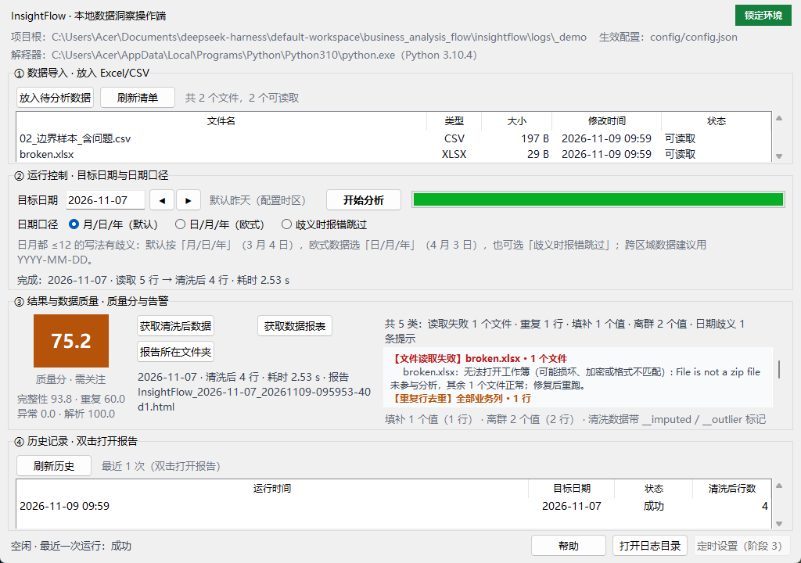

# 阶段 2 交付记录：质量可信与配置（P0 收尾）

> 依据：《InsightFlow 操作端前端要求书》FR-4.1/4.2、FR-5.1–5.4、FR-6.1、FR-8.2/8.4
> 阶段目标：让操作员看清数据风险，完成全部 P0 功能，可用边界样本做商业级最小验收。

---

## 1. 交付内容

| 区块 | 做了什么 | 对应 FR |
|---|---|---|
| 日期口径 | 三个单选（月/日/年、日/月/年、歧义时报错跳过），切换即生效；切换时询问是否写入 `config/config.json`（写入=覆盖配置，故二次确认）；界面附一句歧义说明，术语与文档一致 | FR-4.1 / 4.2 / 8.4 |
| 质量分 | 大字号色块（≥90 优秀绿 / 80 良好 / 60 需关注橙 / <60 较差红）+ 分级文字 + 四项组件（完整性/重复/异常/解析） | FR-5.1 |
| 五类告警 | 顶部一行总览（五类全列），下方逐条：**类型 · 涉及字段/文件 · 数量 · 含义 · 建议**，按严重度排序（读取失败 → 重复 → 填补 → 离群 → 日期歧义） | FR-5.2 |
| 估算与离群 | 每类填补/离群给出字段名与数量，并统计 `__imputed` / `__outlier` 的**行数**；提示"勿把估算值当实测值" | FR-5.3 |
| 坏文件 | 首条告警单列：哪个文件、原因、是否影响其他文件（"未参与分析，其余 N 个文件正常"） | FR-5.4 |
| 历史记录 | 最近 10 次运行（时间/目标日/状态/清洗后行数），双击打开该次报告；无可打开报告时说明原因 | FR-6.1（顺带覆盖 FR-6.2） |
| 友好错误 | 服务层统一把异常翻译成"发生了什么 + 怎么办"（权限/找不到/占用/未知），traceback 只进日志 | FR-8.2 |

截图（真实运行 `examples/acceptance/02_边界样本_含问题.csv` + 一个损坏的 `broken.xlsx`）：



## 2. 质量数据从哪里来（关键设计）

**单一真源：`metrics.json` 的 `quality` 节点。** 界面上的质量分不重新计算，直接读取：

```text
quality_score         → 分数与分级
quality_components    → 完整性 / 重复 / 异常 / 解析
missing_filled        → 缺口（字段 → 值数）
outlier_counts        → 离群（字段 → 值数）
duplicates_removed    → 去重行数
field_stats[].label   → 业务字段名（"新增客户数"而不是 new_customers）
```

行级计数（FR-5.3 的"哪些行"）由 `cleaned_data.csv` 的 `__imputed` / `__outlier` 布尔列统计，
与 metrics 的口径同源；测试同时断言两者一致。日期歧义来自运行告警 `[date_order_ambiguous]`。

## 3. 五类告警的判定规则（可复核）

| 类型 | 判定 | 数量口径 |
|---|---|---|
| 文件读取失败 | `record.files[].status == error` | 文件个数 |
| 重复行去重 | `quality.duplicates_removed > 0` | 删除行数 |
| 缺失值填补 | `quality.missing_filled` 非空 | 填补值个数（附字段名） |
| 离群值标记 | `quality.outlier_counts` 非空 | 标记值个数（附字段名） |
| 日期存在歧义 | 告警中以 `[date_order_ambiguous]` 开头 | 提示条数 |

为零的类别不显示；全部为零时显示"未发现质量问题"（顺带覆盖 FR-5.5）。

## 4. 验证

```text
$env:PYTHONPATH="src"; python -m unittest tests.test_gui_stage2 -v
Ran 11 tests in 18.245s
OK

$env:PYTHONPATH="src"; python -m unittest discover -s tests
Ran 74 tests in 39.174s
OK          （63 + 11）
```

| DoD 要求 | 验证方式 | 结果 |
|---|---|---|
| 边界样本运行，五类告警与质量分同 `metrics.json` 完全一致 | 用例逐项比对 score、五类计数与原始 metrics/CSV 标记 | 通过 |
| 日期口径切换真实生效、无错误术语 | `save_date_order` 往返 + 界面确认/取消两条路径；文档与 UI 文案统一"月/日/年" | 通过 |
| 操作员能区分真实值与填补值 | 分数下方给出填补/离群字段与行数，并指向 `__imputed`/`__outlier` 标记 | 通过 |
| 坏文件不拖垮其他文件 | 边界样本 + 损坏 xlsx：`status=success`、`files_read=1`、首条告警说明影响范围 | 通过 |
| 历史记录可回看 | runs.jsonl → 列表行（时间/目标日/状态/行数），双击打开报告 | 通过 |
| 危险操作有确认 | 写 `config.json` 前二次确认；运行中关窗二次确认 | 通过 |

## 5. 已知边界

1. **告警详情区域是滚动的**：1024×720 下五类全列的总览行常驻可见，逐条详情（每类 2 行）超出时用滚动条。窗口整体请求高度 708 px，适配 1366×768（含任务栏）。
2. **不做历史记录的质量回看**：历史行只显示状态与行数；点开历史报告可看当时的完整质量区。按次质量对比留给阶段 3。
3. **日期口径写入的是 `config/config.json`**（gitignore 中，属运行时配置）；写入失败会明确提示且不影响本次会话已生效的口径。
4. FR-2.5（强制重算）、FR-2.6（只预览）、FR-1.4/1.5（移除/拖拽）、FR-7.x、FR-8.1/8.3 仍属阶段 3。
