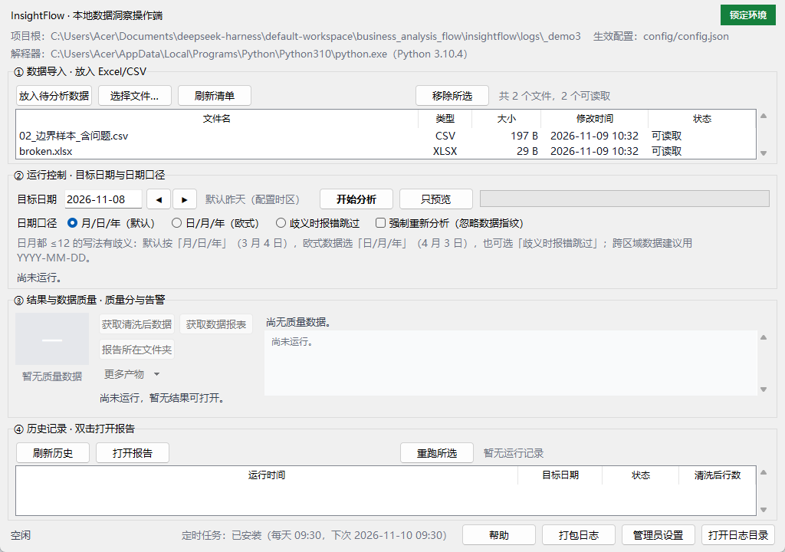
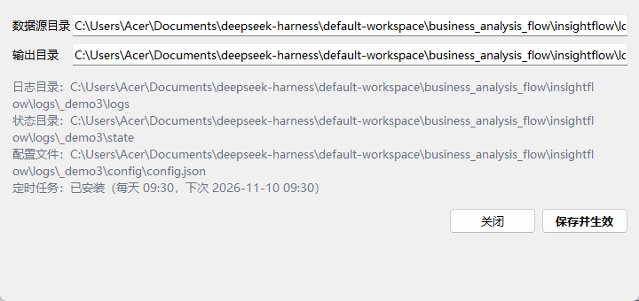

# 阶段 3 交付记录：易用性与增强（P1）

> 依据：《操作端前端要求书》FR-1.4/1.5、FR-2.5/2.6、FR-3.4、FR-4.3/4.4、FR-5.5、FR-6.2/6.3、FR-7.1/7.3、FR-8.1/8.3
> 阶段目标：补齐全部 P1 体验项；业务仍只走 `execute()`，核心零改动。

---

## 1. 逐项交付

| FR | 实现 | 验证 |
|---|---|---|
| 1.4 清单内移除文件 | 「移除所选」→ 二次确认（说明"移到 state/removed，可恢复"）→ 移动文件并刷新清单 | 单测断言文件从 raw 消失、出现在 state/removed；越界路径（`../`）被拒绝 |
| 1.5 拖入窗口 | **未实现真正的拖拽**，见 §4；提供「选择文件…」等价入口：选中的文件复制进数据源目录，重名/不支持类型逐条跳过并汇报 | 单测覆盖复制、重名跳过、不支持跳过 |
| 2.5 强制重新分析 | 勾选「强制重新分析（忽略数据指纹）」→ `execute(force=True)` | 单测：连续两次无 force → 第二次 `skipped`；带 force → `success` |
| 2.6 只预览不生成 | 「只预览」在后台线程调 `services.preview_source()`，弹窗列出预计命中行数、逐表行数与日期列、读取失败、兼容性提示 | 单测断言预览后**没有生成 out 目录**、`summary is None`、文案含"预计命中" |
| 3.4 更多产物入口 | 「更多产物」菜单：报告 HTML / 清洗 CSV / metrics.json / analysis_plan.json / run_record.json，仅列真实存在的文件 | 单测断言 5 类齐全且路径存在 |
| 4.3 路径展示 | 「管理员设置」显示数据源/输出/日志/状态/配置文件，前两项可改 | 单测：保存后设置重新加载、清单刷新 |
| 4.4 设置持久化 | 写回 `config/config.json`（原子写），保留其它键；写入前二次确认（FR-8.4） | 单测：写后 `load_settings` 生效且 `comparison` 等键保留 |
| 5.5 无异常正向反馈 | 无告警时总览显示"未发现质量问题：无填补、无离群、无重复、无坏文件、无日期歧义" | 阶段 2 已覆盖，本阶段正式确认 |
| 6.2 历史报告一键打开 | 「打开报告」按钮（双击等效）；无报告时说明原因 | 单测/复用阶段 2 用例 |
| 6.3 失败可查看与重跑 | 「重跑所选」：若上次失败先显示原因，再确认按该日期重跑 | 代码路径 + 手工验证 |
| 7.1 定时任务状态 | 底部常显"定时任务：已安装（每天 09:30，下次 …）/未安装"；管理员设置内同样展示 | 单测覆盖已安装/未安装两种文案 |
| 7.3 普通视图隐藏系统设置 | 主界面不出现安装/卸载入口；路径与调度状态收进「管理员设置」 | 界面评审 |
| 8.1 首次使用向导 | 首次启动弹三步向导（放数据 → 刷新 → 运行 + 完成后看什么），"不再显示"记入 `state/gui_state.json` | 单测：标记往返 + 关闭向导写标记 |
| 8.3 一键打包日志 | 「打包日志」→ 在输出目录生成 `InsightFlow_logs_<时间>.zip`，含 logs/ 与 environment.txt（Python/依赖版本/路径/口径） | 单测解压校验 environment.txt 与环境条目 |

截图：




## 2. 验证

```text
$env:PYTHONPATH="src"; python -m unittest tests.test_gui_stage3 -v
Ran 13 tests in 19.251s
OK

$env:PYTHONPATH="src"; python -m unittest discover -s tests
Ran 87 tests in 60.853s
OK          （74 + 13）
```

| 检查 | 结果 |
|---|---|
| 业务仍只走 `execute()` | 通过（`gui/services.py` 是唯一调用点，`on_step` 仅观察） |
| 核心零改动 | 通过（本阶段只动 `gui/`、测试与文档） |
| 安全转义未削弱 | 通过（未触碰 `report.py`；阶段 0/1 的黄金样本与安全用例仍绿） |

## 3. 已知取舍

1. **预览弹窗非模态**：方便对照主界面继续操作；代价是可能被主窗口遮挡。
2. **向导只在真实启动时出现**（`python -m insightflow.gui` / 双击 `.bat`）；测试直接构造窗口不会弹向导，避免测试互相干扰。
3. **「更多产物」按存在性列出**：`no_data`/`failed` 时菜单为空并禁用，不会打开空路径。

## 4. 未完成项（必须如实登记）

**FR-1.5 窗口内直接拖拽：未交付。**

- 技术原因：tkinter 原生不支持文件拖放。两条可行路径都要额外代价：
  1. `tkinterdnd2`（内含 tkdnd 二进制）→ 需新增依赖并改 `requirements.lock.txt`，与"不引入未锁定依赖"冲突，且需重新验证锁定环境；
  2. Win32 `DragAcceptFiles` + 子类化窗口过程（ctypes）→ 可零依赖，但原生钩子一旦写错会让整个窗口崩溃，且无法用自动化测试真实模拟 `WM_DROPFILES`（需要真实 HDROP）。
- 当前替代：**「选择文件…」**（`filedialog.askopenfilenames` + `services.import_files`），把文件复制进数据源目录，重复/不支持类型逐条汇报。核心逻辑 `import_files` 已有单测，DnD 若后续接入可复用。
- 建议：单独开一个 spike 分支实现路径 2，用"手工真拖 + 崩溃回归"验收后再并回；或经评审批准引入 `tkinterdnd2` 并更新 lock。

除此之外，本阶段 P1 已全部落地。
